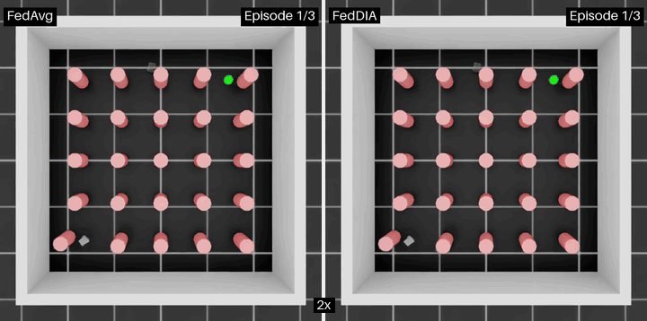
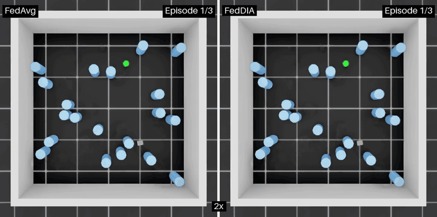
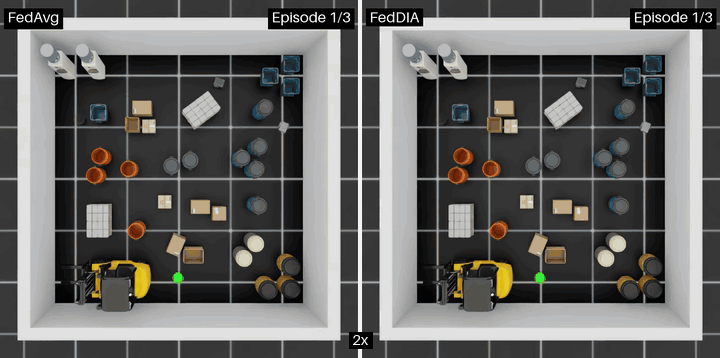
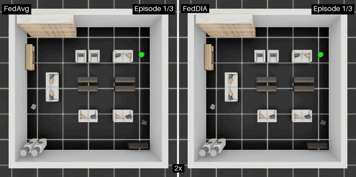

# FedDIA: Difficulty- and Improvement-Aware Aggregation for Federated RL in Robot Navigation


Code for the paper **"Beyond Easy Clients: Difficulty- and Improvement-Aware Aggregation for Federated Reinforcement Learning in Robot Navigation"**.

**Ye Lin Tun, Chu Myaet Thwal, Eui-Nam Huh, Choong Seon Hong**<br>
Kyung Hee University

[[Paper (arXiv)]](https://arxiv.org/abs/2611.25637)

A fleet of robots learns a shared mapless navigation policy with federated reinforcement learning, but the robots rarely operate in the same conditions: an open aisle is mastered quickly, a cluttered room is not. Once a client masters its environment, its updates carry little new information even though its reported return stays high — the *plateau problem*. Uniform averaging (FedAvg) ignores this, and return-weighted aggregation makes it worse.

**FedDIA** weights each client by how much its local training improved the global model it received, amplified by how difficult its environment is. Both signals are measured against the same global model, so they are comparable across clients, and difficulty is inferred from the model's own performance — no description of the environment is needed.

## FedAvg vs FedDIA

<table>
  <tr>
    <td align="center"><br><b>Grid</b> (training environment, fixed layout)</td>
    <td align="center"><br><b>Random</b> (training environment, obstacles resampled every episode)</td>
  </tr>
  <tr>
    <td align="center"><br><b>Warehouse</b> (hand-authored, held out)</td>
    <td align="center"><br><b>Living space</b> (hand-authored, held out)</td>
  </tr>
</table>

*Example episodes chosen to illustrate the behaviour; in each clip both methods face the same spawns and obstacles, and each episode starts together on both sides. Played at 2x speed. Success rates over 1,000 evaluation episodes are in the tables below.*

## Method

Each round, every client evaluates the received global model before training ($r_i^{\text{pre}}$) and its own updated model after training ($r_i^{\text{post}}$). The server then computes

$$
c_i^I = \text{norm}\big(\max(0,\ r_i^{\text{post}} - r_i^{\text{pre}})\big), \qquad
c_i^D = 1 - \text{norm}\big(r_i^{\text{pre}}\big),
$$

$$
\text{score}_i = c_i^I \cdot \big(1 + \alpha\, c_i^D\big), \qquad
w_i = \text{softmax}(\text{score}_i / \tau),
$$

where norm is min-max normalization across clients. Improvement gates the score: a client that did not improve gets no weight from difficulty alone. If no client improves in a round, aggregation falls back to uniform weights. The implementation is the `feddia_m` branch of `resolve_weights` in [`scripts/train_federated_baseline.py`](scripts/train_federated_baseline.py).

## Results

Success rate (%), mean ± std over three seeds, 1,000 evaluation episodes per environment. Eight clients train on *empty* (4), *random* (2) and *grid* (2); *mixed* and *multi-gate* are held out.

| Method | empty | random | grid | mixed | multi-gate | Mean |
|---|---|---|---|---|---|---|
| FedAvg | 99.2 ± 0.7 | 73.1 ± 2.1 | 61.4 ± 12.9 | 49.4 ± 5.3 | 60.2 ± 1.6 | 68.7 ± 4.3 |
| Reward-Weighted | **99.9 ± 0.1** | 64.1 ± 3.0 | 35.9 ± 1.8 | 33.7 ± 0.6 | 55.6 ± 3.3 | 57.9 ± 1.5 |
| FGRL | 98.9 ± 0.6 | 63.6 ± 3.0 | 32.5 ± 9.0 | 31.8 ± 5.0 | 54.8 ± 7.0 | 56.3 ± 4.6 |
| FedKL | 99.2 ± 0.5 | 72.4 ± 5.4 | 58.4 ± 15.4 | 45.4 ± 12.2 | 59.0 ± 6.5 | 66.9 ± 7.9 |
| FedProx | 99.6 ± 0.3 | 73.3 ± 3.0 | 56.6 ± 5.8 | 43.9 ± 5.9 | 64.5 ± 3.1 | 67.6 ± 3.4 |
| **FedDIA** | 98.5 ± 0.4 | **77.4 ± 5.5** | **75.1 ± 7.6** | **59.7 ± 3.7** | **66.8 ± 7.3** | **75.5 ± 3.5** |

Transfer to hand-authored layouts, evaluated without further training (success rate, %):

| Method | Warehouse | Living space |
|---|---|---|
| FedAvg | 49.4 ± 4.8 | 61.3 ± 3.5 |
| Reward-Weighted | 36.1 ± 2.1 | 52.7 ± 7.0 |
| FGRL | 28.7 ± 6.9 | 32.5 ± 11.1 |
| FedKL | 39.7 ± 23.8 | 43.6 ± 27.3 |
| FedProx | 50.5 ± 5.0 | 61.1 ± 11.4 |
| **FedDIA** | **61.6 ± 3.6** | **74.8 ± 6.7** |

Collision and timeout rates, the local-training references, ablations, a defective-client study and partial participation are in the paper.

## Setup

Requires Linux, an NVIDIA RTX GPU supported by Isaac Sim 5.1, and Docker with the NVIDIA Container Toolkit. Everything runs inside the container.

```bash
cd docker
./build.sh                 # Isaac Sim 5.1.0 + Isaac Lab (pinned commit, see docker/.env)
./run.sh headless          # or ./run.sh for the GUI; --gpu <index> to pick a GPU
# inside the container (the repo is mounted at /home/rl_user/workspace):
bash docker/verify.sh
```

Isaac Lab v2.3.0 does not work (the LiDAR needs `MultiMeshRayCaster`, added after it); the container installs a newer pinned commit.

## Usage

All commands run inside the container from the repo root.

**Train** (the paper's configuration; swap `--method` for the baselines):

```bash
/opt/IsaacLab/isaaclab.sh -p scripts/train_federated_baseline.py --headless \
    --method feddia_m --feddia_m_alpha 1.0 --temperature 1.0 \
    --weight_normalization minmax \
    --client_modes "none*4,random*2,dense*2" \
    --rounds 60 --local_timesteps 300000 --num_envs 256 \
    --eval_episodes 200 --pre_eval_episodes 200 \
    --keep_global_history --seed 42
```

Methods: `feddia_m` (FedDIA), `fedavg`, `reward_weighted`, `fgrl`, `fedkl` (`--fedkl_lambda1/2`), `fedprox` (`--fedprox_mu`), `difficulty_only` (ablation), `isolated` (local training only). Runs are written to `logs/<method>/run_<timestamp>_seed_<seed>/`, with per-round global models in `global_agent_states/round_XXX.pt`.

**Evaluate** a checkpoint in every environment:

```bash
/opt/IsaacLab/isaaclab.sh -p scripts/evaluate_sequential.py --headless \
    --model_path logs/feddia_m/<run>/global_agent_states/round_060.pt \
    --eval_modes none,random,dense,random_dense,gate_palisade_multi,factory,living \
    --eval_episodes 1000
```

`scripts/evaluate_rounds.sh --run-dir <run> --rounds 60 --eval-modes <csv>` runs the same evaluation for one or more rounds of a run.

**Watch** a policy (needs the GUI, so start the container with `./run.sh`):

```bash
/opt/IsaacLab/isaaclab.sh -p scripts/play.py \
    --model_path logs/feddia_m/<run>/global_agent_states/round_060.pt --obstacle_mode dense
```

**Environment names.** The code and the paper name the obstacle modes differently:

| Paper | `--obstacle_mode` / `--client_modes` |
|---|---|
| empty | `none` |
| random | `random` |
| grid | `dense` |
| mixed | `random_dense` |
| multi-gate | `gate_palisade_multi` |
| warehouse | `factory` |
| living space | `living` |

## Pretrained models

The round-60 global models of FedDIA and FedAvg for all three seeds (the checkpoints behind the tables) are attached to the [GitHub release](../../releases). Pass one to `play.py` or `evaluate_sequential.py` with `--model_path`.

## Citation

```bibtex
@article{tun2026feddia,
  title   = {Beyond Easy Clients: Difficulty- and Improvement-Aware Aggregation for Federated Reinforcement Learning in Robot Navigation},
  author  = {Tun, Ye Lin and Thwal, Chu Myaet and Huh, Eui-Nam and Hong, Choong Seon},
  journal = {arXiv preprint arXiv:2611.25637},
  year    = {2026}
}
```

## License

BSD 3-Clause, see [LICENSE](LICENSE).
